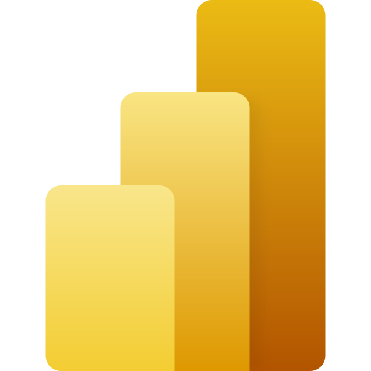

<p align="center" style="font-size:300%">


<h1 align="center">ClickHouse Arrow Flight Connector for Power BI (Beta)</h1>
</p>
<br/>

## Introduction

A dedicated Power BI connector for ClickHouse's [Arrow Flight SQL interface](https://clickhouse.com/docs/interfaces/arrowflight), built on the Microsoft-distributed ADBC driver. It returns a foldable navigation table: Power Query and DAX operations are pushed down into ClickHouse SQL (DirectQuery supported).

The classic, generally-available ODBC-based connector ("ClickHouse") lives on the `main` branch and is unchanged; this connector is its Flight-SQL successor and does not require an on-premises data gateway host with a ClickHouse driver — the ADBC driver ships inside Power BI.

## Requirements

- ClickHouse server with the Arrow Flight SQL interface enabled (`arrowflight_port`)
- Power BI Desktop 2.155 (June 2026) or later
- Connections are **always TLS-encrypted** (certificate and hostname validated against the system trust store) — there is no plaintext mode; the server's Flight endpoint must be configured with TLS (`arrowflight.enable_ssl`)

## Usage

Get Data → **ClickHouse Arrow Flight** → server + `arrowflight_port` (+ optional database). Options record supports `HighPrecision` (default `true`: ClickHouse Decimal stays exact in aggregates).

```
ClickHouseArrowFlight.Database("my-server", 9005, "default")
```

## Known limitations

- Plain `DateTime` columns surface as Int64 epoch seconds (use `DateTime64`); fix tracked server-side.
- Outer merges are evaluated by Power Query rather than folded (`join_use_nulls` cannot be pinned per connection yet).
- Per-connection server settings are not yet supported by the server's Flight interface.
- Column types the ADBC reader cannot fetch (FixedString, UUID, IPv6, Int128/256, Decimal with precision > 38, JSON) are excluded from tables; reach them via `Value.NativeQuery` with a server-side conversion.

## Development and testing

`./build-mez.sh` builds `ClickHouse.mez`. The automated suite (37 query tests + connection-validation scenarios, run against a ClickHouse version matrix with server-side verification of the generated SQL) lives under `Tests/` — see `Tests/README.md`.
